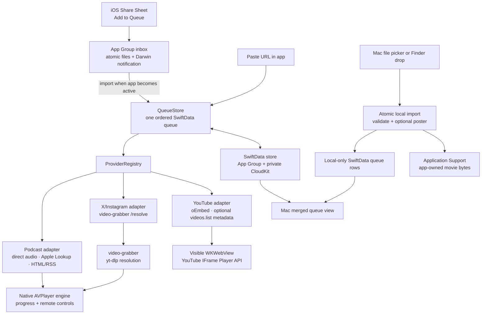

# MushRadio

MushRadio is a native iPhone, iPad, and Mac app with one ordered queue for
podcast episodes, X/Instagram videos, YouTube videos, and Mac-imported movie
files. It is intentionally not a discovery app: add a public URL from the iOS
Share Sheet or either app, or import a movie on Mac, then press Play.

The minimum deployment targets are iOS 17 and macOS 14 because the apps use
SwiftData. They are built with SwiftUI, SwiftData, and CloudKit. Podcasts,
resolved social videos, and local movies use AVFoundation; YouTube uses public
oEmbed metadata everywhere, plus an optional iOS-restricted Data API key and
the IFrame Player API in the iOS app.

> [!IMPORTANT]
> YouTube does not permit third-party API clients to extract audio, download
> videos, or keep a YouTube player running while it is hidden or in the
> background. Consequently, the exact “audio-only, lock-screen, uninterrupted”
> experience is available for podcasts only. See
> [YouTube playback and policy](#youtube-playback-and-policy).

## Architecture



Key implementation boundaries:

- `ListenLaterShare` validates one shared public HTTPS URL and quickly writes a
  `PendingShare` file into the App Group. It does not perform network resolution
  or write to CloudKit while the host app is holding the extension open.
- The containing app drains the inbox on launch/activation and immediately when
  the running process receives the cross-process notification. Receipt IDs make
  crash recovery idempotent before metadata resolution begins.
- Podcast resolution supports direct audio URLs, Apple Podcasts episode links
  through Apple’s Lookup API, standard HTML RSS/Atom discovery, and RSS enclosure
  matching.
- X status links and supported Instagram post/reel links are sent to the
  self-hosted `video-grabber` `/resolve` API. The original post URL is durable;
  the returned signed MP4 URL is treated as short-lived and refreshed before
  later playback.
- Videos can be shared from Now Playing or a queue item’s long-press menu. The
  outgoing share contains the canonical source page, never a short-lived media
  URL.
- YouTube URL parsing yields a video ID. Without configuration, the public
  oEmbed endpoint supplies the title, channel, and artwork, and playback opens
  in YouTube. When a Data API key is configured, `videos.list` also supplies
  duration, embedding status, and made-for-kids status so eligible videos can
  play in the app.
- `QueueStore` persists queue order, item state, and playback progress. A
  CloudKit-backed SwiftData store synchronizes those values through the user’s
  private iCloud database; foreground refreshes reconcile remote changes.
- `ListenLaterMac` presents a native split view and merges the CloudKit-backed
  link queue with a separate local-only SwiftData queue. Finder drops and the
  file importer copy movies into app-owned Application Support storage using a
  staged, validated, atomic commit.
- Mac local-video rows and movie bytes never enter CloudKit. This is a deliberate
  compatibility boundary: an already-installed iOS build cannot misinterpret a
  new `localVideo` source as a podcast. Unknown source values in newer data are
  also rendered as unsupported rather than falling back to podcast behavior.
- Colours come from the icon’s walnut and brass. `Design/README.md` lists the
  colour tokens, their contrast ratios, and how the icon’s dark and tinted
  versions were made.

## YouTube playback and policy

Policy behavior was reviewed on July 30, 2026. Re-check the current policies
before each release.

YouTube’s [Developer Policies](https://developers.google.com/youtube/terms/developer-policies)
prohibit API clients from separating YouTube audio from video, downloading or
extracting media, and playing YouTube content in a background player that is not
displayed on the screen the user is viewing. The
[Required Minimum Functionality](https://developers.google.com/youtube/terms/required-minimum-functionality)
also requires a visible official player, an OS-provided WebView on Apple
platforms, a viewport of at least 200 by 200 points/pixels, unobscured controls,
client identity, and visibility before scripted autoplay.

MushRadio therefore behaves as follows:

- A YouTube queue item stores a video ID, never an audio or downloadable media
  URL.
- Playback uses YouTube’s official
  [IFrame Player API](https://developers.google.com/youtube/iframe_api_reference)
  in a visible `WKWebView`, with YouTube controls and branding intact.
- Leaving the app, locking the device, or moving the player off screen pauses
  YouTube playback. The app clears Now Playing information and disables
  lock-screen/Bluetooth remote commands for YouTube.
- While the device is locked or the app is in the background, X and
  Instagram clips keep playing as audio (the default **Continuous Play for
  Clips** setting): a clip playing when you lock the device or leave the app
  carries on, the clips after it play one after another, and each is marked
  played when it ends. With it off, the system pauses a clip nobody can see,
  and a podcast that finishes while locked skips over videos to the next
  podcast and leaves the videos in Up Next; when only videos remain, the
  queue waits for the app to return to the foreground.
- YouTube videos always wait for the screen. In the background the queue
  plays on past them and leaves them in Up Next; it waits for the app to
  return to the foreground only when nothing else can play.
- Foreground auto-advance is attempted only while the player is visible.
  WebKit/YouTube may still block autoplay; the app then asks the user to tap
  Play.
- A video can be embedded only after a configured Data API request verifies its
  `status.embeddable` and `status.madeForKids` values. Without that verification,
  the item remains in the queue but opens in the official YouTube app or site.
- A video whose official `status.embeddable` value is false remains in the
  queue but opens in YouTube instead of constructing an embedded player.
- With a Data API key configured, a video whose official `status.madeForKids`
  value is true is conservatively handed off to the official YouTube app or
  website instead of being embedded. This is a MushRadio product choice, not a
  claim that every made-for-kids embed is categorically prohibited.
- MushRadio does not scrape YouTube pages, suppress advertisements, alter the
  player, cache video, download media, or isolate an audio track.
- It displays each video’s current API metadata without aggregating YouTube
  durations into a cross-source queue total or deriving a completion metric
  from Data API duration. Playback completion comes from the official player’s
  terminal event.

The combined queue remains useful and ordered, but YouTube videos can't join a
continuous background queue under the current YouTube rules, so the queue plays
on past them and leaves them for the screen. This is the closest seamless
behavior that preserves the official audiovisual player and its playback
context.

Relevant official references:

- [YouTube API Services Terms of Service](https://developers.google.com/youtube/terms/api-services-terms-of-service)
- [YouTube API Services Developer Policies](https://developers.google.com/youtube/terms/developer-policies)
- [YouTube API Services Required Minimum Functionality](https://developers.google.com/youtube/terms/required-minimum-functionality)
- [YouTube video resource: `embeddable` and `madeForKids`](https://developers.google.com/youtube/v3/docs/videos)
- [YouTube IFrame Player API](https://developers.google.com/youtube/iframe_api_reference)

## Requirements

- Xcode with the iOS 17 SDK or newer
- macOS 14 or newer for the Mac app
- An active Apple Developer Program membership with permission to create App
  Groups and iCloud containers
- An iPhone or iPad signed into iCloud for CloudKit and background-audio
  validation
- Optionally, a Google Cloud project with YouTube Data API v3 enabled and a
  restricted key for in-app YouTube playback, richer metadata, and preflight
  status checks
- A reachable deployment of
  [`Kevinmthau/video-grabber`](https://github.com/Kevinmthau/video-grabber)

Simulator builds are useful for UI and deterministic tests. They are not
sufficient evidence for CloudKit delivery, Share Sheet behavior across host
apps, lock-screen controls, Bluetooth routing, interruptions, or App Store
signing.

## Optional YouTube Data API key setup

YouTube links can be added without an API key. In that mode the app uses
YouTube's public oEmbed metadata and opens playback in the official YouTube app
or site. A Data API key additionally provides duration, embeddability, and
made-for-kids status so eligible videos can play in MushRadio's visible official
player.

The app reads `YOUTUBE_API_KEY` through `Config/Base.xcconfig`. Keep the actual
key in the ignored local file:

```sh
cp Config/Secrets.xcconfig.example Config/Secrets.xcconfig
```

Then edit `Config/Secrets.xcconfig`:

```xcconfig
YOUTUBE_API_KEY = YOUR_KEY_HERE
```

Do not put the key in `Base.xcconfig`, source code, a committed scheme, or the
README. `Config/Secrets.xcconfig` is already ignored by Git.

Create the key:

1. In [Google Cloud Console](https://console.cloud.google.com/), create or
   select the project for this app.
2. Enable **YouTube Data API v3**. Google’s
   [Data API overview](https://developers.google.com/youtube/v3/getting-started)
   describes the project, credentials, and quota model.
3. Create a standard API key under **APIs & Services > Credentials**.
4. Set **API restrictions** to **YouTube Data API v3** only.
5. Set **Application restrictions** to **iOS apps** and allow the containing
   app’s exact bundle identifier, `com.kevinthau.ListenLater`. Requests made
   with an iOS-restricted key must send the matching
   `X-Ios-Bundle-Identifier` header.
6. Monitor quota and rejected requests. Use separate development and production
   credentials; do not create extra projects to evade quota.

Google recommends both API and application restrictions in its
[API key security documentation](https://docs.cloud.google.com/docs/authentication/api-keys#api_key_restrictions).
An API key shipped in an iOS app can still be extracted. Restrictions, quotas,
monitoring, and rotation limit its usefulness; the `.xcconfig` file prevents
accidental source-control disclosure but does not make the compiled key secret.

The current app uses only public, non-authorized YouTube metadata. It does not
sign the user into Google or request OAuth scopes. Adding and refreshing
YouTube items falls back to public oEmbed metadata when this key is absent,
invalid, restricted incorrectly, over quota, or temporarily unavailable.

The app also identifies the embedded player by loading its HTML with an HTTPS
bundle-ID origin and passing the same origin to the IFrame Player API. YouTube
player error `153` usually means that this client identity/referrer context is
missing or rejected. Verify the bundle identifier and player origin before
changing the player implementation. If `videos.list` requests fail separately,
also verify the API-key restriction.

## video-grabber setup

The checked-in app points at:

```text
https://twitter-video-grabber-production.up.railway.app/resolve
```

Change `VIDEO_GRABBER_ENDPOINT` in `ListenLater/Info.plist` if the Railway
service moves. The current deployment requires `RESOLVE_API_TOKEN`; set its
matching value only in the ignored `Config/Secrets.xcconfig`:

```xcconfig
VIDEO_GRABBER_API_TOKEN = YOUR_RESOLVE_API_TOKEN
```

The token is compiled into the personal iOS app and should be treated as an API
credential, not as an unextractable secret. Rotate it if a distributed build is
shared beyond trusted devices.

The app posts the shared X or Instagram URL to `/resolve`, validates the returned
public HTTPS media endpoint, and streams it with the native player. It does not
save a copy into Photos or download the video for offline use. `video-grabber`
direct URLs can expire quickly, so `QueueItem` stores an expiration time and
automatically calls `/resolve` again before playback when needed. When the
next item is a social video, its link is refreshed while the current item has
under a minute left, so automatic advances don't pause to fetch it. Private or
protected posts still depend on the server’s `COOKIES_FILE` configuration.

## Signing, identifiers, and capabilities

Use unique explicit bundle identifiers under one Apple Developer team. The
Share Extension identifier must begin with the containing app’s identifier.
Select **Automatically manage signing** unless the organization deliberately
manages profiles itself.

The checked-in project contains these targets and identifiers:

| Target | Product | Bundle identifier |
| --- | --- | --- |
| `ListenLater` | Containing iOS app | `com.kevinthau.ListenLater` |
| `ListenLaterShare` | “Add to Queue” Share Extension | `com.kevinthau.ListenLater.AddToQueue` |
| `ListenLaterTests` | Unit-test bundle | `com.kevinthau.ListenLaterTests` |
| `ListenLaterMac` | Native macOS app | `com.kevinthau.ListenLaterMac` |
| `ListenLaterMacTests` | macOS unit-test bundle | `com.kevinthau.ListenLaterMacTests` |

The repository’s shared identifiers are:

```xcconfig
APP_GROUP_IDENTIFIER = group.com.kevinthau.ListenLater
ICLOUD_CONTAINER_IDENTIFIER = iCloud.com.kevinthau.ListenLater
```

If you use a different organization or bundle identifier, update the following
as one coordinated change:

- All five target bundle identifiers
- `APP_GROUP_IDENTIFIER` and `ICLOUD_CONTAINER_IDENTIFIER` in
  `Config/Base.xcconfig`
- The App Group and iCloud container registrations in the Apple Developer
  portal
- The `com.apple.developer.ubiquity-kvstore-identifier` value in
  `ListenLater/ListenLater.entitlements`
- The iOS bundle identifier allowed by the Google API key
- Provisioning profiles for the iOS app, Share Extension, and Mac app

Configure the containing app target:

- **App Groups**: enable `group.com.kevinthau.ListenLater`
- **iCloud**: enable CloudKit and select
  `iCloud.com.kevinthau.ListenLater`
- **Background Modes**: enable **Audio, AirPlay, and Picture in Picture** and
  **Remote notifications**

Configure the Share Extension target:

- **App Groups**: enable the exact same App Group
- Do not give the extension background-audio or CloudKit capabilities; it uses
  the shared inbox and the containing app performs resolution and persistence.

Configure the Mac app target:

- **App Sandbox**: enable outgoing network connections and user-selected file
  read access.
- **App Groups**: enable `group.com.kevinthau.ListenLater`.
- **iCloud**: enable CloudKit and select
  `iCloud.com.kevinthau.ListenLater`.
- Do not add broad file-system entitlements. The security-scoped file-picker
  permission is held only while the selected movie is copied into the sandbox.

Apple documents these steps in
[Adding capabilities](https://developer.apple.com/documentation/xcode/adding-capabilities-to-your-app),
[Configuring App Groups](https://developer.apple.com/documentation/xcode/configuring-app-groups),
and [Syncing SwiftData across devices](https://developer.apple.com/documentation/swiftdata/syncing-model-data-across-a-persons-devices).

After changing capabilities, clean the build folder, let Xcode regenerate
profiles, and inspect the signed app and extension entitlements if the runtime
falls back to local-only storage.

## CloudKit setup and schema promotion

The app requests a SwiftData `ModelConfiguration` in the App Group container,
backed by the user’s private CloudKit database. If CloudKit setup fails, it
falls back first to an App Group local store and then to an app-sandbox store.
A build without the App Group entitlement goes straight to the app-sandbox
store, because SwiftData terminates the app instead of throwing when a
configuration names an App Group it can’t use. When the app hosts the unit
tests, it uses an in-memory store instead and, like demo mode, leaves the
Share Extension inbox alone.
That fallback keeps the app usable, but it can hide an entitlement mistake.
Open **Settings** (the gear) in the app and confirm **iCloud Sync: On** before
considering setup complete. While sync has fallen back to a local store, a
crossed-out cloud also appears beside the gear.

While the app is foregrounded, it re-reads its SwiftData queue when the store
posts `NSPersistentStoreRemoteChange`, which CloudKit imports trigger, so
changes from other devices appear without a scene transition. Bursts of
notifications are coalesced to one refresh per half second, and a refresh every
30 seconds covers any missed notification. Reconciling playback with the store
writes only when another device's progress disagrees with this one, so this
device's own saves don't trigger more saves. CloudKit transport itself remains
asynchronous.

Queue order is a fractional `sortRank`. A move gives only the moved item a rank
between its neighbours, so it changes one record rather than renumbering the
queue; the queue is renumbered only when two neighbours get closer than
0.001.

Development setup:

1. Confirm the containing app’s iCloud entitlement contains
   `iCloud.com.kevinthau.ListenLater`, and the `remote-notification` background
   mode is present.
2. Run a normal, non-demo Debug build on an unlocked device signed into iCloud.
3. Add and mutate queue items so SwiftData initializes and exercises the
   development schema.
4. Open [CloudKit Console](https://icloud.developer.apple.com/), select the
   container and **Development** environment, and inspect the generated record
   types and fields.
5. Test create, update, reorder, progress, unavailable state, and delete flows
   on two unlocked devices using the same iCloud account. CloudKit sync is
   asynchronous; allow time for background import/export.

Before TestFlight or App Store distribution:

1. Freeze and review the model shape. CloudKit-backed SwiftData does not support
   uniqueness enforcement, and relationships would need to be optional.
2. In CloudKit Console, select **Deploy Schema Changes**, review the changes,
   and deploy them to **Production**.
3. Build an archive signed for distribution and verify its iCloud container
   environment and entitlements.
4. Test the production environment with TestFlight on at least two devices.

App Store builds can access only the production schema. Deploying the schema
copies types, fields, and indexes, not development records. Production schemas
are effectively additive: plan migrations before promotion because deployed
types and fields cannot simply be removed. See Apple’s
[schema deployment guide](https://developer.apple.com/documentation/cloudkit/deploying-an-icloud-container-s-schema).

### Cross-version and local-video compatibility

The shared `QueueItem` schema gained only optional or defaulted local-media
fields. Link-backed records continue to use the same CloudKit store and record
shape, and their source values remain `podcast`, `socialVideo`, or `youtube`.
The Mac app never inserts `localVideo` into that container: it writes dedicated
`LocalQueueRecord` rows to the non-CloudKit `ListenLaterMacLocalQueue`
configuration instead.

That split is required for safe staged rollout. Existing iOS versions treat an
unrecognized source value as podcast, so syncing a local-video record would be
unsafe even if the movie bytes were absent. Keeping the entire row local means
old and current iOS installations see exactly the shared link queue they
already understand. The current model also maps genuinely unknown future
values to an explicit unsupported source as defense in depth.

## macOS app and local movie lifecycle

Select the `ListenLaterMac` scheme to run the native macOS 14 app. It uses a
`NavigationSplitView` queue, keyboard commands, Settings scene, context menus,
drag reordering, file importer, and Finder URL drops. Podcasts and resolved
social videos use the shared native playback engine. YouTube always opens the
official app or website on Mac; Mac metadata resolution intentionally passes an
empty Data API key and uses public oEmbed rather than silently reusing the
iOS-bundle-restricted credential.

Movie import is transactional:

1. MushRadio starts security-scoped access to each selected Finder URL.
2. It copies the file into an app-owned `.partial-<UUID>` staging directory.
3. AVFoundation verifies that the copy is playable, has a video track, and has
   a positive finite duration; it also reads dimensions and best-effort creates
   a poster JPEG.
4. The staging directory is atomically renamed into
   `Application Support/MushRadio/LocalMedia/Media/<UUID>`.
5. Only then is a local SwiftData row saved, containing a UUID, sanitized
   filenames, title, duration, and dimensions—never the original path, a
   security-scoped bookmark, or media bytes.

Cancellation or validation failure removes the partial copy. Startup removes
stale partials, moves unreferenced owned media into the internal Trash, and
derives availability from the copied file at runtime. Missing bytes show **Not
on this Mac** and automatic playback skips the row without marking it played or
unavailable. Delete removes the local metadata first and then moves only the
UUID-derived owned directory to internal Trash; Undo can restore both. Trash is
purged after seven days. No cleanup operation accepts or deletes an external
user path.

## Share Extension setup and verification

The extension display name is **Add to Queue**. Its activation rule accepts one
web URL. It also attempts a plain-text URL when a host supplies text rather than
`public.url`.

The extension classifies the link from the URL alone (`LinkClassifier`), with
no network access. It refuses links MushRadio can't play and says why: Spotify
and Apple Music links, TikTok, X or Instagram pages that aren't posts, YouTube
links without a video, and Apple Podcasts show pages. It accepts other web pages
with a note that MushRadio will look for a podcast episode on them.

After installing the containing app:

1. Open MushRadio once.
2. In X, Safari, Podcasts, YouTube, or another host app, open the Share Sheet.
3. If needed, choose **More**, enable **Add to Queue**, and pin it to favorites.
4. Share a public HTTPS URL and select **Add to Queue**.
5. Wait for the “Added to Queue” confirmation, then activate MushRadio.
6. Confirm the item appears at the bottom and changes from resolving to ready or
   unavailable.

An empty queue shows these steps in the app, with a **Paste** button for a link
that’s already copied.

If the extension reports that the App Group is unavailable, verify that both
targets are signed by the same team, both profiles include the same registered
App Group, and the extension is embedded in the containing app.

The extension intentionally returns quickly after an atomic inbox write and
posts a payload-free Darwin notification. A running containing app stages the
receipt promptly—even during active background podcast playback—and then
resolves metadata. If iOS has suspended or terminated the app, the durable file
is imported on its next activation. Damaged inbox files are moved to a
quarantine directory instead of being retried forever. Apple’s extension guide
documents [App Group data sharing and activation rules](https://developer.apple.com/library/archive/documentation/General/Conceptual/ExtensibilityPG/ExtensionScenarios.html).

## Podcast background audio

Podcast enclosures play through `AVPlayer` with an `AVAudioSession` configured
as `.playback` and `.spokenAudio`. The app publishes podcast Now Playing
metadata and supports play, pause, next, seek, 15-second back, 30-second forward,
and playback-rate commands through `MPRemoteCommandCenter`.

The containing app’s `audio` background mode lets an active podcast continue
when the screen locks or the app backgrounds. The code also handles audio
interruptions, pauses when an old output route becomes unavailable, and marks
an item unavailable after a 30-second startup/rebuffer watchdog expires so the
queue can continue. AirPlay and Bluetooth A2DP are enabled.

Native X/Instagram playback uses the same engine. The inline video is sized to
the video's own shape (a vertical reel is tall and narrow), has a full-screen
button that opens the system player (which may rotate to landscape and offers
Picture in Picture and AirPlay), and continues in Picture in Picture when you
leave the app while it plays. By default, **Continuous Play for Clips** is on:
a clip keeps playing as audio when you lock the device or leave the app without
Picture in Picture, and automatic advances made in the background play X and
Instagram clips as audio, one after another, and mark them played when they
end. For this the engine sets the player's
`audiovisualBackgroundPlaybackPolicy` to `.continuesIfPossible`; otherwise iOS
pauses a player whose video is showing in the app as soon as the app leaves the
screen. Turning the setting off saves clips for the screen instead: the system
pauses a clip nobody can see, the queue plays the next podcast and leaves
videos in Up Next, and a video that is reached with no audio left is loaded but
paused. Rows for videos that will wait show **Needs screen**.
Do not enable or simulate background YouTube playback. See Apple’s
[AVAudioSession guidance](https://developer.apple.com/documentation/avfaudio/avaudiosession)
and [background execution modes](https://developer.apple.com/documentation/xcode/configuring-background-execution-modes).

## Running the app

1. Configure signing, capabilities, and CloudKit as described above. Configure
   the optional YouTube Data API key if in-app YouTube playback is desired.
2. Open `ListenLater.xcodeproj` in Xcode.
3. Select the `ListenLater` scheme and a simulator or signed device.
4. Build and run.

Command-line build:

```sh
xcodebuild \
  -project ListenLater.xcodeproj \
  -scheme ListenLater \
  -destination 'platform=iOS Simulator,name=iPhone 17 Pro' \
  build
```

Mac Debug build:

```sh
xcodebuild \
  -project ListenLater.xcodeproj \
  -scheme ListenLaterMac \
  -configuration Debug \
  -destination 'platform=macOS' \
  build
```

If that simulator is not installed, replace the destination with one listed by
`xcrun simctl list devices available`.

### Simulator demo queue

Add `-DemoQueue` to **Product > Scheme > Edit Scheme > Run > Arguments Passed On
Launch**. Demo mode uses an in-memory SwiftData store and inserts three
representative queue rows. It skips CloudKit, pending Share Extension imports,
and YouTube metadata refresh.

Demo mode is for deterministic UI inspection and screenshots. Its example
podcast URLs are not playable media, changes disappear on termination, and it
must not be used to validate persistence, providers, playback, or sync.

## Running tests

From Xcode, select the `ListenLater` scheme and choose **Product > Test**.

Command line:

```sh
xcodebuild \
  -project ListenLater.xcodeproj \
  -scheme ListenLater \
  -destination 'platform=iOS Simulator,name=iPhone 17 Pro' \
  test
```

The 180-test automated suite is deterministic and does not require a live API
key or network access: 160 iOS tests plus 20 Mac-specific tests.

- `ProviderParsingTests` covers supported and hostile YouTube and social-video
  URL forms, video-grabber request/response behavior, expiration handling,
  canonicalization, and duration parsing.
- `ProviderRegistryTests` covers provider dispatch plus invalid and unsupported
  URLs.
- `ProviderHTTPClientTests` covers controlled redirects and private-endpoint
  rejection without live network access.
- `RSSFeedTests` covers RSS/Atom fixtures, enclosures, metadata, matching hints,
  and malformed XML.
- `QueueStoreTests` uses an in-memory SwiftData container for append, reorder,
  Play Next, delete, played state, unavailable state, progress throttling,
  YouTube completion boundaries, expiring social-video URLs, and refreshes from
  another model context.
- `PlaybackCoordinatorPodcastEngineTests` uses a fake podcast engine for resume,
  native social-video playback, completion, failure/skip, seeking, rate,
  continuous clip play in the background, and the foreground-only YouTube
  boundary.
- `SharedQueueInboxTests` verifies chronological atomic-file handoff and retry
  behavior, cross-process notifications, receipt-idempotent relaunch recovery,
  multi-receipt staging, and malformed-file quarantine.
- `LocalMediaLibraryTests` verifies staged commit, failed-import cleanup,
  symbolic-link rejection, relaunch availability, internal Trash/Undo and its
  retention clock, orphan reconciliation, and stale partial cleanup without
  touching external paths.
- `LocalQueueCompatibilityTests` verifies the non-CloudKit local store,
  snapshot round trips, no share URL for local movies, and safe unknown-source
  handling.
- `MacPlaybackCoordinatorTests` verifies automatic skip of missing local bytes
  without mutating ready/played state and rejects stale async playback starts.

Run the Mac suite separately:

```sh
xcodebuild \
  -project ListenLater.xcodeproj \
  -scheme ListenLaterMac \
  -destination 'platform=macOS' \
  test
```

GitHub Actions runs the same suite on an iOS Simulator for every pull request
and push to `main` (`.github/workflows/ci.yml`). The workflow also regenerates
the Xcode project and fails if `ListenLater.xcodeproj` no longer matches
`Scripts/generate_project.rb`, so add new source files by re-running the script:

```sh
ruby Scripts/generate_project.rb
```

The provider adapters accept an injected `URLSession` so network response tests
run without live services. Live video-grabber, YouTube, CloudKit, Share Sheet,
lock-screen, and Bluetooth behavior belong in the real-device checklist below.

## Real-device release checklist

### Installation and configuration

- [ ] Install a non-demo build on two supported devices using the same iCloud
  account.
- [ ] In Settings, confirm **iCloud Sync: On**, and under **Diagnostics**
  confirm the intended YouTube metadata mode and **Video resolver token: Set**.
- [ ] If using the Data API, confirm an iOS-restricted key succeeds and
  rejected-key/quota errors are understandable.
- [ ] Confirm the production build contains the intended app, extension, App
  Group, iCloud, and background-mode entitlements.

### Share and resolution

- [ ] Share one podcast episode URL from Safari or a podcast site.
- [ ] Share Apple Podcasts and direct enclosure URLs.
- [ ] From X, share a public status containing video and verify that it becomes
  ready, plays inline, saves progress, and resumes after relaunch.
- [ ] Wait at least five minutes before starting a queued X video and verify
  that the direct media URL is transparently refreshed.
- [ ] Verify protected/deleted X posts, a bad resolver token, resolver timeout,
  and rate limiting produce understandable retryable states.
- [ ] Share YouTube watch, short, live, mobile, and `youtu.be` URLs.
- [ ] Confirm rapid extension completion and import when MushRadio activates.
- [ ] Confirm the share sheet refuses a Spotify link with a reason.
- [ ] Confirm unsupported, malformed, authenticated, and deleted items become
  unavailable with a readable reason in the row,
  tapping them offers Try Again, Open Original Link and Delete, and the queue
  continues.
- [ ] Turn off networking during resolution, then retry from the item menu.

### Podcast playback

- [ ] Resume a partially played episode after terminating and relaunching.
- [ ] Lock the device and verify uninterrupted podcast audio.
- [ ] Verify lock-screen and Control Center play/pause, position, rate, back,
  forward, and next controls.
- [ ] Verify Bluetooth headphones/car audio and AirPlay routing.
- [ ] Disconnect headphones and confirm playback pauses.
- [ ] Test phone/Siri/alarm interruptions and route restoration.
- [ ] Let an item finish and confirm automatic advance.
- [ ] Make an enclosure fail during playback and confirm unavailable marking
  and skip-to-next behavior.

### Clip playback

- [ ] With **Continuous Play for Clips** on, start an X video, lock the
  device, and verify its audio carries on and the next clip starts when it
  ends. Repeat by leaving the app with Picture in Picture turned off in iOS
  Settings, and by locking the device while the clip shows in Picture in
  Picture.
- [ ] With it on, leave the app while an X video plays in Picture in
  Picture, then close the Picture in Picture window; verify the clip pauses
  rather than playing on unseen.
- [ ] With it on, put a YouTube video between two X videos and lock the
  device during the first; verify the second X video plays next and the
  YouTube video stays in Up Next.
- [ ] With it off, lock the device while an X video plays and verify it
  pauses where it was rather than finishing unseen.

### YouTube playback

- [ ] Without a Data API key, confirm a shared video becomes ready with oEmbed
  metadata, offers **Open in YouTube**, and never loads the embedded player.
- [ ] Confirm the visible official player is at least 200 by 200 and all YouTube
  controls/branding remain usable and unobscured.
- [ ] Confirm metadata, duration, `embeddable`, and made-for-kids behavior come
  from `videos.list`.
- [ ] Background and lock the device; verify YouTube pauses and no YouTube
  lock-screen remote controls remain.
- [ ] Verify an autoplay-blocked transition presents a tap-to-play state.
- [ ] Verify non-embeddable videos offer **Open in YouTube**, while removed
  videos are marked unavailable and skipped.
- [ ] Verify made-for-kids items offer **Open in YouTube**.
- [ ] Finish a foreground YouTube item and verify foreground queue advance.
- [ ] With **Continuous Play for Clips** off, finish a background podcast
  immediately before a YouTube or X video with another podcast after it;
  verify the second podcast plays and the video stays in Up Next. With no
  podcast left, verify the app waits for the foreground rather than playing
  the video invisibly.

### Queue and sync

- [ ] Reorder, delete, mark played/unplayed, and move an item to Play Next.
- [ ] Start an item from the middle of Up Next and confirm it moves to the
  top; press Next and confirm the skipped item keeps its progress at the end.
- [ ] Delete an item and clear Played, then Undo each.
- [ ] Verify every item’s independent playback position.
- [ ] Confirm queue changes and progress reach the second device.
- [ ] Make edits on both devices close together and inspect deterministic order
  and last-write behavior.
- [ ] Test while signed out of iCloud and after signing back in.
- [ ] Confirm local-only fallback shows a crossed-out cloud beside the
  Settings gear rather than being mistaken for active sync.

### Mac local movies

- [ ] Import several `.mov`/`.mp4` files through the picker and by dragging
  them from Finder; confirm the original files can be moved afterward and the
  copied movies still play.
- [ ] Cancel a large import and try a corrupt or audio-only file; confirm no
  queue row or partial media directory remains.
- [ ] Relaunch the app and confirm local rows, posters, order, and progress are
  restored from local storage.
- [ ] Remove a copied movie while the app is closed; confirm the row says **Not
  on this Mac**, is skipped automatically, and is not marked played or
  unavailable.
- [ ] Delete a local movie, use Undo, then allow an internal Trash item to age
  past seven days and confirm maintenance removes it.
- [ ] On an iPhone running the previous shipping build, confirm Mac imports do
  not appear while new link-backed additions and reorders still sync.
- [ ] Confirm YouTube opens externally on Mac and no iOS-restricted Data API
  credential is sent by the Mac target.

### Look and feel

- [ ] Check the Home Screen icon in light, dark, and tinted appearances, with
  no white at its corners.
- [ ] With an empty queue, follow the on-screen steps to add **Add to Queue** to
  the share sheet’s favorites, and confirm **Paste** adds a copied link in
  light and dark mode.
- [ ] Check the walnut and brass controls, the playing row, and stand-in artwork
  in light and dark mode.

## Metadata retention and privacy release requirements

The app stores the user’s original URLs, ordered queue, playback progress, and
resolved metadata locally and in the user’s private CloudKit database. For
social videos it also stores the temporary direct media URL and its expiration
time; the durable identifier remains the original post URL. It parses a YouTube
video ID from the user-provided URL. Public YouTube metadata stored by the app
includes title, channel name, and thumbnail URL. When the Data API is
configured, it also stores duration, embeddability, and made-for-kids status.
It does not currently request Google login or authorized YouTube account data.

YouTube’s
[Developer Policies](https://developers.google.com/youtube/terms/developer-policies)
require limited non-authorized API data to be deleted or refreshed within 30
calendar days. MushRadio schedules a refresh when cached YouTube metadata is
29 days old. Cleanup runs on launch, activation, and periodically while the app
process is active. If refresh still cannot succeed once the cached data reaches
30 days, the app clears the stored YouTube title, channel, thumbnail, duration,
fetch date, and API status flags, then marks the item unavailable. It retains
the user-provided URL, its parsed video ID, and the queue record so the user can
retry or delete the saved reference. As with any client-only iOS app, work is
not guaranteed while the process is suspended or never reopened; a strict
server-enforced deadline would require a backend metadata service.

Before distributing the app, publish and require acceptance of an easily
accessible privacy policy and terms surface. The current information screen
links the YouTube Terms and Google Privacy Policy, but it is not itself a
complete published app privacy policy and does not yet provide the
release-required acceptance flow. The policy must, at minimum:

- State that the app uses YouTube API Services.
- Link to the [YouTube Terms of Service](https://www.youtube.com/t/terms) and
  state that use of the YouTube feature is subject to those terms.
- Link to the [Google Privacy Policy](https://policies.google.com/privacy).
- Explain exactly which URLs, queue data, progress, and API metadata the app
  stores; that queue data syncs through the user’s private iCloud database; and
  how users delete it.
- Explain that the visible YouTube player communicates playback context to
  YouTube/Google and may use cookies or similar device/browser storage.
- Identify network requests to Google/YouTube, Apple’s Lookup API, podcast
  publishers, RSS hosts, audio/video CDNs, the configured video-grabber service,
  X/Instagram media infrastructure, artwork hosts, and Apple iCloud.
- Provide a developer contact and a clear deletion-request process.
- If OAuth or authorized YouTube data is added later, link Google’s
  [security permissions page](https://security.google.com/settings/security/permissions),
  implement revocation, and delete authorized data within the policy deadlines.

Also complete App Store Connect’s App Privacy answers from the final behavior
and published policy. Do not treat this developer README as the user-facing
privacy policy or legal terms.

## Known MVP limitations

- YouTube cannot play in the background, from the lock screen, as audio-only
  media, or while its official player is hidden. In the background the queue
  plays on past YouTube videos, leaving them in Up Next, and stops at one only
  when nothing else can play.
- WebKit or YouTube can require a fresh user gesture even when foreground
  autoplay is requested.
- Private, age-restricted, region-restricted, live-state-restricted, removed, or
  embedding-disabled YouTube videos may fail or require the official YouTube
  app.
- When a Data API key is configured, made-for-kids videos are conservatively
  handed to YouTube rather than embedded.
- Without a Data API key, YouTube items have no duration or preflight status
  flags and playback opens in the official YouTube app or site.
- X and Instagram support depends on the self-hosted video-grabber deployment,
  its current `yt-dlp` compatibility, rate limits, and any cookies required for
  protected content. Only save media you are authorized to access.
- Generic podcast page resolution depends on a discoverable RSS/Atom link and a
  confident match to an episode enclosure. JavaScript-only pages, private feeds,
  paywalls, unusual feeds, and pages with no standards-based feed discovery can
  fail.
- Direct audio URLs may not provide show, artwork, or duration metadata until
  playback.
- Plain HTTP podcast pages, feeds, and enclosures are rejected. MushRadio
  intentionally requires public HTTPS URLs and does not weaken App Transport
  Security with a blanket exception.
- A running app receives Share Extension additions through a cross-process
  notification. If iOS has suspended or terminated it, additions remain safely
  in the App Group inbox until the next activation.
- CloudKit sync is asynchronous rather than real-time. Simultaneous queue
  reorders or progress writes on several devices use normal SwiftData/CloudKit
  conflict behavior rather than a collaborative CRDT. Because a move changes
  only the moved item's record, moves of different items on two devices
  usually both survive; two devices moving the same item keep the later move.
- The MVP streams media and does not download podcasts or social videos for
  offline listening.
- There are no recommendations, discovery feeds, accounts, CarPlay UI, or Apple
  Watch app. On iPad (regular width), the player and the queue sit side by side.
- Imported movie bytes are intentionally local to one Mac. Other Macs and iOS
  devices receive only link-backed queue items; moving a local movie between
  Macs requires importing it separately on the destination Mac.
- CloudKit production schema promotion and the in-app YouTube privacy/terms
  acceptance flow are release gates, not optional polish.

## Production references

- [Apple: Adding capabilities to your app](https://developer.apple.com/documentation/xcode/adding-capabilities-to-your-app)
- [Apple: Configuring App Groups](https://developer.apple.com/documentation/xcode/configuring-app-groups)
- [Apple: Syncing SwiftData across a person’s devices](https://developer.apple.com/documentation/swiftdata/syncing-model-data-across-a-persons-devices)
- [Apple: Deploying an iCloud container schema](https://developer.apple.com/documentation/cloudkit/deploying-an-icloud-container-s-schema)
- [Apple: Configuring background execution modes](https://developer.apple.com/documentation/xcode/configuring-background-execution-modes)
- [Apple: Configuring an app for media playback](https://developer.apple.com/documentation/avfoundation/configuring-your-app-for-media-playback)
- [Apple: Remote command center](https://developer.apple.com/documentation/mediaplayer/mpremotecommandcenter)
- [Apple: Share Extension data sharing and activation](https://developer.apple.com/library/archive/documentation/General/Conceptual/ExtensibilityPG/ExtensionScenarios.html)
- [Apple: iTunes Search API lookup examples](https://developer.apple.com/library/archive/documentation/AudioVideo/Conceptual/iTuneSearchAPI/LookupExamples.html)
- [YouTube: Data API overview](https://developers.google.com/youtube/v3/getting-started)
- [YouTube: `videos.list`](https://developers.google.com/youtube/v3/docs/videos/list)
- [YouTube: Video resource](https://developers.google.com/youtube/v3/docs/videos)
- [YouTube: Made for Kids status](https://developers.google.com/youtube/v3/guides/made_for_kids_status)
- [YouTube: IFrame Player API](https://developers.google.com/youtube/iframe_api_reference)
- [YouTube: Developer Policies](https://developers.google.com/youtube/terms/developer-policies)
- [YouTube: Required Minimum Functionality](https://developers.google.com/youtube/terms/required-minimum-functionality)
